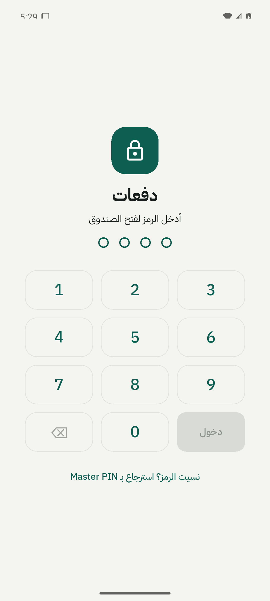
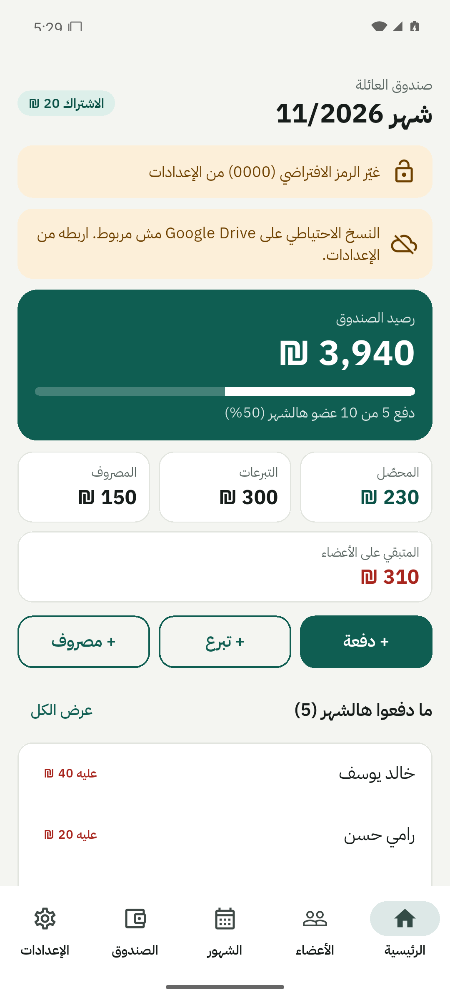
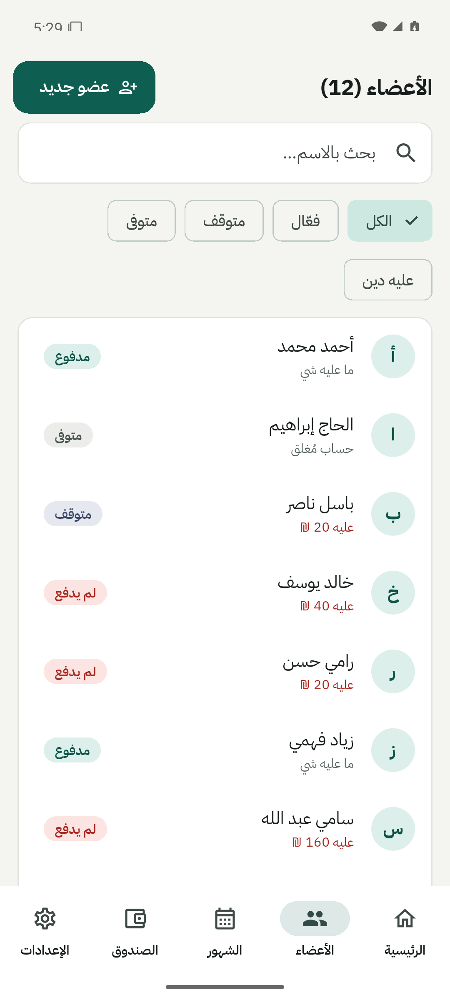
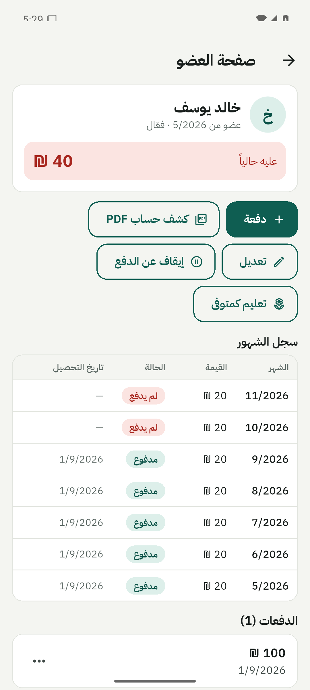
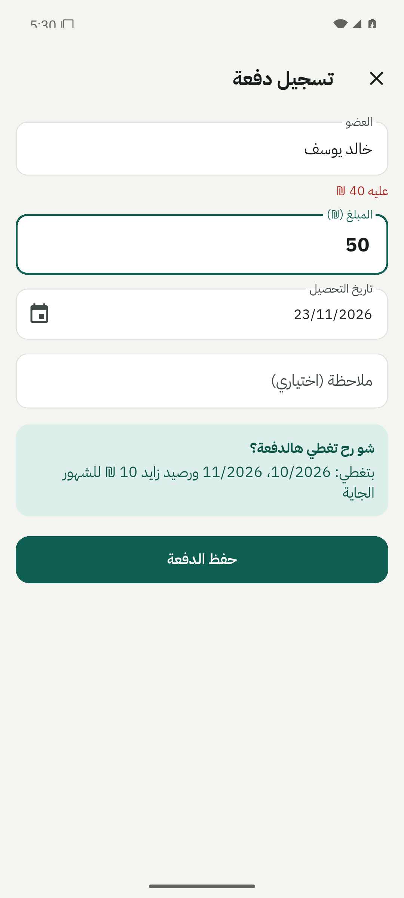
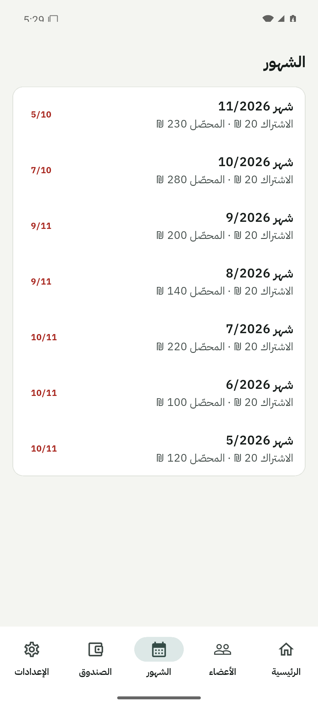
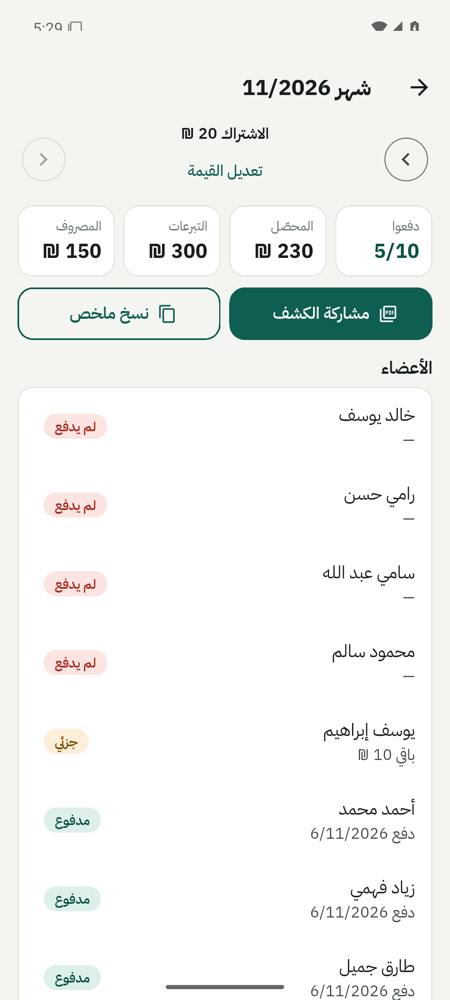
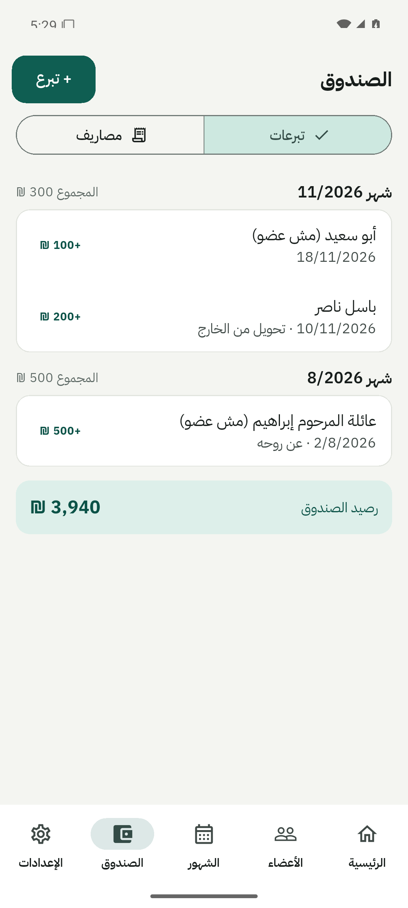
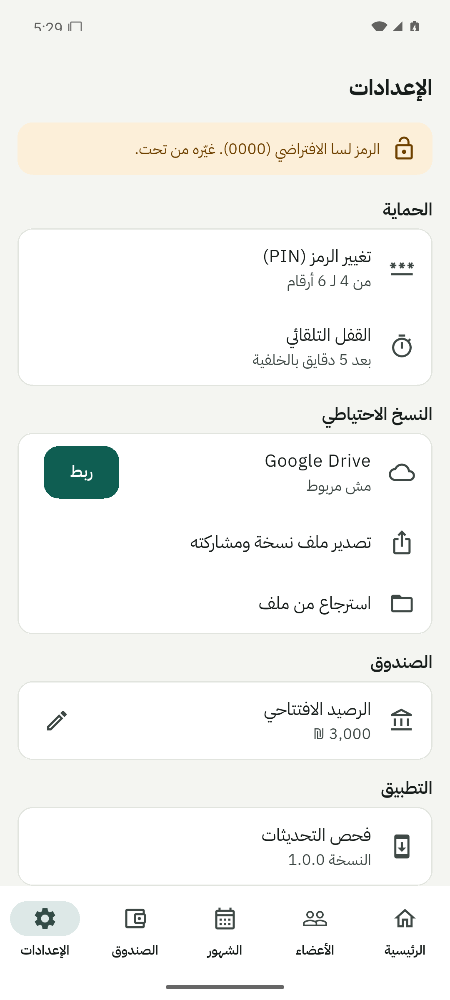
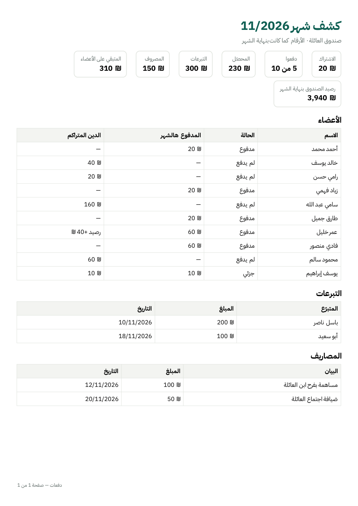

# دفعات — تطبيق صندوق العائلة

تطبيق Android لتسجيل الاشتراكات الشهرية لصندوق العائلة: الدفعات، والتبرعات، والمصاريف، والكشوفات.

## التنزيل

نزّل آخر نسخة (`.apk`) من صفحة **[Releases](../../releases/latest)**، وثبّتها على التلفون.

- أول مرة لازم تسمح بـ "تثبيت تطبيقات من مصادر غير معروفة".
- الرمز الافتراضي عند أول فتح: `0000`. غيّره من الإعدادات.
- بعد هيك، التحديثات بتوصل لحالها من داخل التطبيق.

## لقطات شاشة

| | | |
|---|---|---|
|  |  |  |
|  |  |  |
|  |  |  |

**كشف شهري PDF:**

> الأسماء والأرقام باللقطات تجريبية.

هالريبو فيه نسخ التطبيق بس. الكود بريبو خاص.
